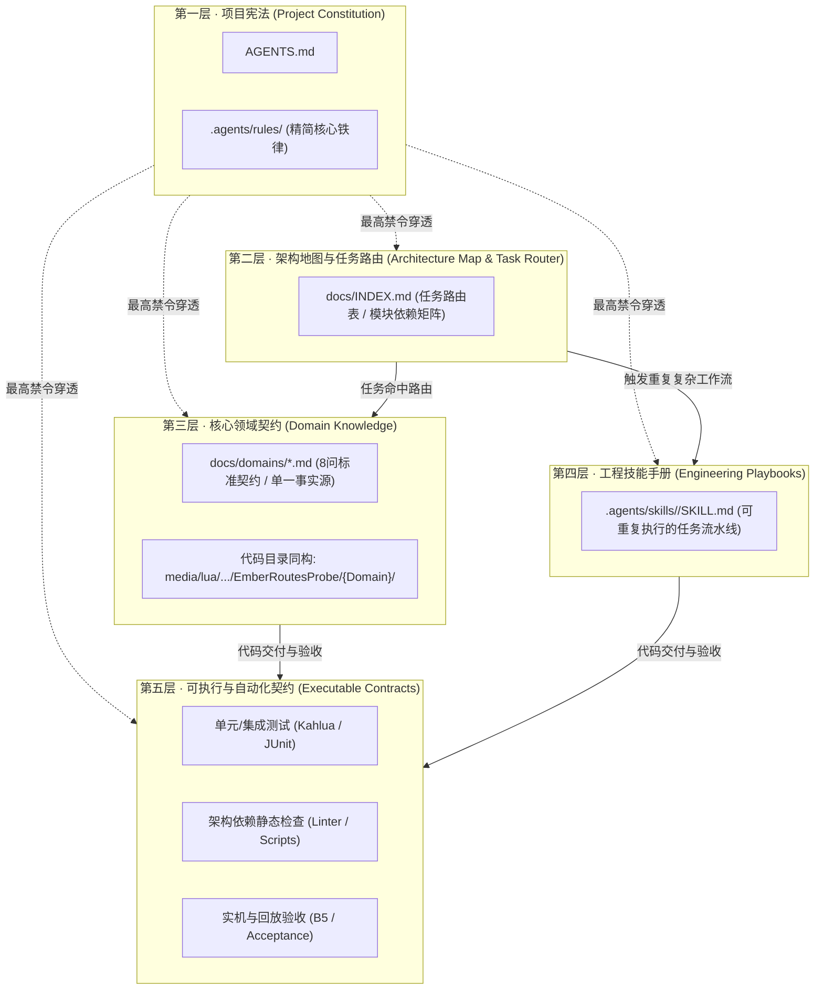
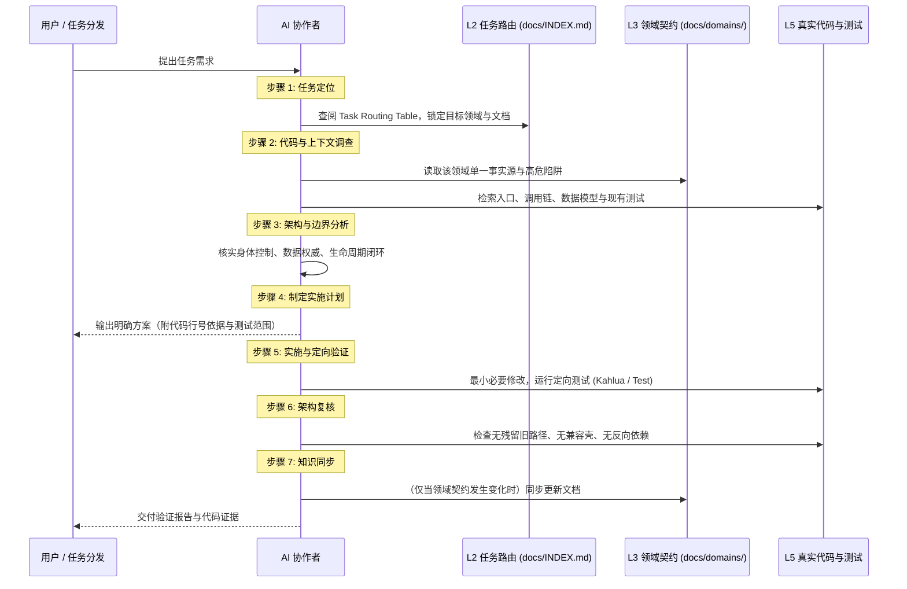

# EmberRoutes AI 工程上下文体系实施规范
# (AI Engineering Context System Implementation Spec)

> 版本：v1.0.0｜生效日期：2026-11-06｜状态：Draft -> Active  
> 适用范围：EmberRoutes 全体 AI 代理、人类协作者及自动化构建流水线。

---

## 1. 核心宗旨与设计哲学

在复杂且长期演进的工程项目中，**AI 协作的最大挑战不是“读完所有文件”，而是在承接具体任务时，能否在有限的上下文窗口中“快速建立正确的局部心智模型”，且在修改过程中“绝对不越过架构边界”**。

本规范确立的 **五层 AI 工程知识与工程约束系统**，旨在替代冗长、易腐烂的“大部头说明书”，构建一套：
- **以代码为事实**（Code as Fact）
- **以架构为约束**（Architecture as Boundaries）
- **以文档为导航**（Docs as Navigation & Maps）
- **以技能为手册**（Skills as Playbooks）
- **以测试与工具为真理验证**（Tests & Checks as Executable Truth）

的现代化 AI 工程协作成熟度体系。

---

## 2. 五层体系架构与职责定义



### 2.1 各层职责与生命周期矩阵

| 层级 | 载体形态 | 加载时机 | 核心回答的问题 | 变更频率 | 维护责任人 |
| :--- | :--- | :--- | :--- | :--- | :--- |
| **L1 项目宪法** | `AGENTS.md`<br>`.agents/rules/*.md` | **永久全量加载**<br>(每次会话启动) | 项目是什么？绝对不能破坏什么底线？ | 极低（仅架构战略调整） | 架构师 / 用户裁决 |
| **L2 架构地图** | `docs/INDEX.md` | **全局导航索引**<br>(承接任务第一步) | 这个问题该去哪里找？涉及哪些模块？ | 低（模块/路由增减时） | 模块负责人 / AI 提交 |
| **L3 领域契约** | `docs/domains/*.md` | **按需动态加载**<br>(进入特定领域时) | 这个业务如何运转？谁是数据权威？状态如何流转？ | 中（领域契约演进时） | 领域开发者 |
| **L4 工程技能** | `.agents/skills/*/` | **按任务类型加载**<br>(执行标准流程时) | 这类重复性开发任务的标准步骤是什么？ | 低（最佳实践提炼） | 全体协作者 |
| **L5 可执行契约**| 测试脚本 / 检查工具 | **CI/本地执行验证**<br>(提交前必跑) | 代码是否真的正确？是否破坏既有契约？ | 高（随代码提交同步更新）| 每次代码提交者 |

---

## 3. 工具层加载与防截断机制（P0 规约）

### 3.1 现实约束：预算上限与静默降级
实地审计发现，当前环境（Antigravity）对全局自动注入的规则设有 **20,000 Tokens 预算上限**。当规则文件体积超标时，排在后面的文件会被**静默降级为纯路径指针**，不再展开内容，导致关键约束失效。

### 3.2 L1 宪法收口治理原则
1. **L1 只保留跨领域、长期稳定、错误代价极高的全局铁律**：
   - 专注单人模式、拒绝历史兼容与转发壳（Zero-Compatibility / No Fallback）；
   - 代码证据前置与反谄媚（Code Grounding & Anti-Sycophancy）；
   - 角色身体控制单点独占（Single Body Control Point）；
   - 生产测试服从生产契约（Living Contracts）。
2. **垂直领域规则移出全局 L1**：
   - 将特定于表现层的 `ui-framework-invariants.md` 移入 `docs/domains/ui.md` 或 L4 UI 专属 Skill；
   - 将特定于国际化的 `i18n-invariants.md` 转化为自动化校验工具（`tools/check-i18n.py`）作为硬性门禁，不再占用全局 Token 预算。
3. **消除冗余与单点引用**：
   - 同一条规则不在 `AGENTS.md` 和 `.agents/rules/` 中重复展开；
   - 规则文件总 token 预算严控在 8,000 tokens 以内，确保 100% 每次会话完全展开。

---

## 4. 标准模版定义

### 4.1 L2: 任务路由表标准格式 (Task Routing Table)
收录在 `docs/INDEX.md` 中，按任务意图直接路由：

```markdown
| 任务类型 | 核心关注领域 | 必读契约文档 (L3) | 核心代码入口 (Code) | 必经测试/验证 (L5) | 关联技能 (L4) |
| :--- | :--- | :--- | :--- | :--- | :--- |
| **新增/调整工种** | Work / Kernel | `docs/domains/work.md` | `client/.../Work/PublicWorkProviders.lua`<br>`shared/.../Work/LaborStore.lua` | `KahluaLaborTest`<br>`tools/audit-npc-control.mjs` | `add-provider` |
| **修改仓储/物流** | Logistics / Warehouse | `docs/domains/logistics.md` | `client/.../Logistics/DeliveryService.lua`<br>`shared/.../Warehouse/WarehouseIndex.lua` | `tests/lua/warehouse-*-test.lua` | `modify-logistics` |
| **调整据点 UI** | UI / Settlement | `docs/domains/ui.md` | `client/.../UI/SettlementDashboard.lua` | `tools/test-ui-kahlua.ps1` | `develop-ui-page` |
```

### 4.2 L3: 领域知识契约 8 问模版 (Domain Spec Template)
每个物理子目录必须在 `docs/domains/<domain-name>.md` 中对齐以下 8 项标准契约：

```markdown
# 领域名称 (如 Cooking / Field / Logistics)

## 1. 领域职责与非职责 (Scope & Non-Goals)
- 负责：...
- 绝对不负责（由谁负责）：...

## 2. 数据权威与持久事实 (Single Source of Truth)
- 权威状态存储位置（如 ModData 中的具体 Record 结构）：
- 内存派生缓存与释放机制：

## 3. 业务生命周期状态流 (Lifecycle State Machine)
- 状态跃迁图 (Mermaid)：
- 认领 (Claim) -> 执行 (Work) -> 收集 (Collect) -> 交付 (Deliver) -> 结清 (Settled)

## 4. 对外服务契约 (Public API / Boundaries)
- 允许外部调用的 Service 入口：
- 严格禁止的跨域调用反模式：

## 5. 依赖方向与拓扑 (Dependencies)
- 允许依赖的下层/横向领域：
- 严格禁止的反向依赖：

## 6. 物理代码映射 (Code Grounding)
- Client 端核心文件清单：
- Shared 端核心文件清单：

## 7. 契约测试与验证基线 (Executable Contracts)
- 对应单元测试文件：
- 对应集成/Kahlua 回归命令：

## 8. 高危陷阱与架构暗礁 (Gotchas & Risks)
- AI 或开发者最容易违背的隐性边界（例如：绕过认领直接瞬移物品、未释放配额导致地块死锁）：
```

### 4.3 L4: 工程技能手册模版 (Playbook / Skill Template)
存放于 `.agents/skills/<skill-name>/SKILL.md`，指导 AI 按标准作业程序（SOP）行动：

```markdown
---
name: add-provider
description: 指导 AI 按照标准工种生命周期新增或重构一个工作工种（Provider）
---

# SOP: 新增工作工种执行手册

## 步骤 1：契约核对
- 检查 `ProviderContract` 基础规约；
- 明确认领配额（Directory Claim）与取消退避。

## 步骤 2：身体授权与执行会话
- 经由 `TaskController` 申请身体控制；
- 禁止直接驱动角色 `ISTimedActionQueue`。

## 步骤 3：原件责任闭环
- 实现 PREPARE -> WORK -> COLLECT -> DELIVER 责任清偿；
- 严禁产物散落或个人背包滞留。

## 步骤 4：自动化回归验证
- 运行针对该工种的单元测试断言。
```

---

## 5. AI 开发七步工作流契约 (AI Workflow Invariants)

所有接入 EmberRoutes 开发的 AI Agent，在执行代码修改时必须严格遵循以下**七步闭环**：



---

## 6. 文档治理与反腐烂铁律

1. **单一事实源（No Duplication）**：
   禁止在多个文档中复制同一套数据结构或规则描述。子文档只使用 Markdown 锚点或文件路径引用上层定义。
2. **按需创建（No Speculative Docs）**：
   仅对物理目录划分明确、具有独立业务逻辑的核心领域（如 `Cooking`、`Field`、`Settlement`）创建 L3 文档，严禁为纯工具目录、展示性纯叶子目录过度创建文档。
3. **契约变更同步（Atomic Updates）**：
   只有当数据权威模型、生命周期状态跃迁或公共 API 发生变更时，才允许更新对应的 L3 领域契约；禁止在每次微小代码重构后机械性地通篇重写文档。
4. **自动化检查门禁（Automated Invariant Check）**：
   逐步将架构约束从“文字描述”转化为“自动化测试”（例如检查 `shared/` 严禁 `require "client/..."`，UI 严禁直接写入 `ModData`）。

---

## 7. 实施落地路线图

- [ ] **P0：核实并收口规则加载**
  - 清理 `.agents/rules/`，移出垂直领域规则，确保核心宪法 100% 稳定加载且不被系统静默截断。
- [ ] **P1：重构 [docs/INDEX.md](file:///c:/Users/MuMu/Zomboid/Workshop/EmberRoutes/docs/INDEX.md)**
  - 基于最新物理目录结构（`Activity`, `Cooking`, `Crafting`, `Field`, `Hauling`, `Leisure`, `Logistics`, `SelfCare`, `Settlement`, `Warehouse`, `Work`, `Kernel`），建立正式的系统架构拓扑与《任务路由索引表》。
- [ ] **P2：按优先级建立核心领域契约 (`docs/domains/`)**
  - 首批优先建设易产生边界歧义的领域：`settlement.md`、`work.md`、`logistics.md`、`field.md`。
- [ ] **P3：固化高频开发技能 (`.agents/skills/`)**
  - 首批封装：`add-provider`（新增工种 SOP）、`verify-runtime`（构建与 Kahlua/实机验证 SOP）。
- [ ] **P4：强化自动化架构防线**
  - 将架构禁忌写入静态检查或集成测试，彻底由机器守护边界。
