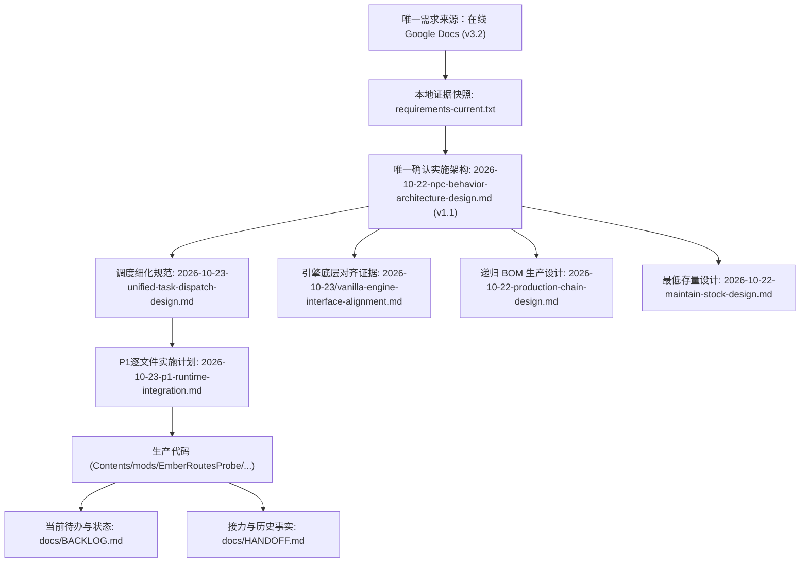
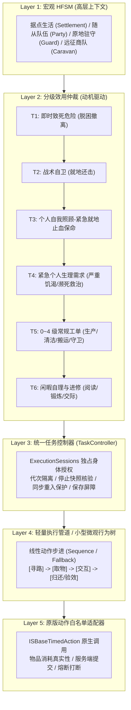
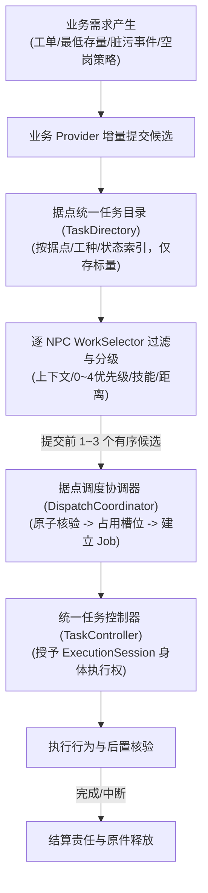
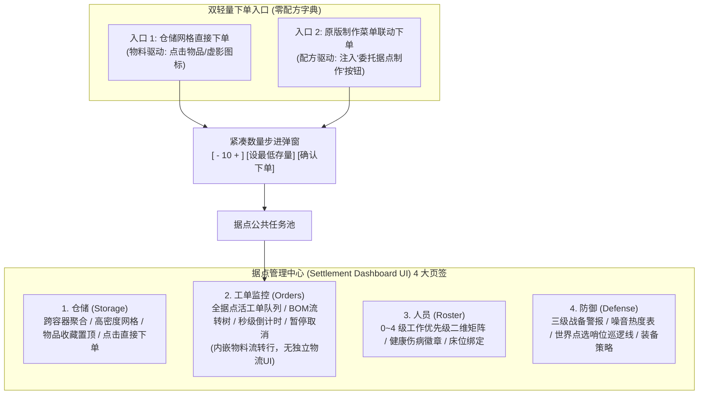

# EmberRoutes（余烬商路）全景架构与综合设计文档

> 导航澄清（2026-10-24）：本文件为综合整理参考，下方版本、运行环境及阶段状态是原整理截点，不作为当前兼容承诺或第二份NPC实施设计。NPC工作从[唯一架构](superpowers/specs/2026-10-22-npc-behavior-architecture-design.md)进入，当前进度见[BACKLOG](BACKLOG.md)，按任务查[导航](INDEX.md)。

> **版本**：v1.2（综合整理版）｜**基线运行环境**：Project Zomboid B42.21+ / B41.78+ ｜ **状态**：架构已确认，P1控制器实施中

---

## 1. 核心愿景与玩法循环

EmberRoutes（余烬商路）旨在解决《Project Zomboid》中后期生存资源过剩、大本营缺乏动态威胁、幸存者无目标感的痛点。深度融合社区模拟经营、物理工序生产与商队大地图贸易。

### 1.1 核心设计哲学
1. **《Kenshi》式物理实体映射**：全物理真实库存（货架有物才可卖、箱中有物才可用），无凭空刷物；真实体能磨练与伤情模拟。
2. **《环世界》（RimWorld）式优先级调度**：0~4 级工作优先级二维矩阵，拒绝死板排班；需求自然驱动，急救自卫最高优先级打断。
3. **《我的世界》（Tom's Simple Storage / AE2）式极简流式仓储**：跨容器聚合盘点、高密度角标网格、以物料为驱动的快捷下单与递归物料清单（BOM）自动拆解。
4. **尊重原版引擎与物理常识**：凡 PZ 原版已有的系统（农业 `SFarmingSystem`、阅读 `ISReadABook`、炉灶热模拟 `IsoStove`、发电机维保 `ElectronicsMag4`），100% 走原生接口，不凭空生造伪机制。
5. **单人完整首发，保留专服权威接口（SP-First Fallback）**：本地世界执行者为唯一权威，保留网络同步与专服接口抽象，严禁在未验证前虚标联机可用。

### 1.2 核心玩法闭环

---

## 2. 文档系统图谱（单一事实来源）

整个仓库遵循严密的文档权威分工，杜绝出现相互冲突的“平行需求”：

| 文档路径 | 权威地位与职责 |
|---|---|
| [在线需求快照](file:///c:/Users/MuMu/Zomboid/Workshop/EmberRoutes/docs/reviews/2026-10-23/requirements-current.txt) | **唯一业务需求来源**。所有玩法规格与界面交互的基准。 |
| [NPC行为架构已确认设计 (v1.1)](file:///c:/Users/MuMu/Zomboid/Workshop/EmberRoutes/docs/superpowers/specs/2026-10-22-npc-behavior-architecture-design.md) | **唯一系统实施架构入口**。固定五层决策、执行会话独占、保存屏障与阶段验收。 |
| [全任务统一调度细化设计](file:///c:/Users/MuMu/Zomboid/Workshop/EmberRoutes/docs/superpowers/specs/2026-10-23-unified-task-dispatch-design.md) | **任务与认领契约**。TaskDirectory、WorkSelector、DispatchCoordinator、公共/私有流转与UI裁剪。 |
| [原版底层对齐审查证据](file:///c:/Users/MuMu/Zomboid/Workshop/EmberRoutes/docs/reviews/2026-10-23/vanilla-engine-interface-alignment.md) | **引擎机制红线**。医疗两阶段、农业、烹饪、水利、发电机、枪械排障、走廊让行 7 大硬性接口。 |
| [HANDOFF.md](file:///c:/Users/MuMu/Zomboid/Workshop/EmberRoutes/docs/HANDOFF.md) & [BACKLOG.md](file:///c:/Users/MuMu/Zomboid/Workshop/EmberRoutes/docs/BACKLOG.md) | **唯一执行记录与接力入口**。记录版本进度、未验证边界、下一步行动。 |

---

## 3. 五层混合 AI 决策与执行架构

为解决多 NPC 在复杂生存环境下的状态震荡与算力浪费，采用严格分层的混合架构：

### 3.1 核心不变量与执行安全
* **身体执行权唯一**：每个 NPC 在同一时刻只能拥有一个激活的 `ExecutionSession`；任何新任务抢占必须经历：`发出停止请求 -> 禁止派发新动作 -> 等待原生动作停稳(或硬超时3秒熔断) -> 保存恢复点/义务 -> 授予新代次会话`。
* **持料挂起强制优先恢复**：若 NPC 在生产取料后因口渴暂停了任务，在喝水自理结束后，**必须强制优先恢复原工单**；若配方已被玩家取消，则必须**先执行归还物料的 Obligation**，严禁背着斧头木板去接扫地单导致物料被肉身绑架。
* **单人挂起上限硬约束**：单个 NPC 背包持有生产原料时，除个人喝水吃药自理外，严禁挂起第 2 个工作。

---

## 4. 全任务统一调度与认领体系 (Unified Task Dispatch)

彻底废除“每种工种各造一套派工器与任务池”，所有任务共用一套生命周期：

### 4.1 三类候选分流原则
1. **公共工作（PUBLIC）**：制作、烹饪、清洁、搬运、守卫、农业。由合适 NPC 依据 0~4 优先级竞争认领。创建时不绑定人员。
2. **个人需求（PERSONAL）**：吃喝、自救止血、休息、跟随指令。属于 NPC 本地效用仲裁激发的内部驱动，**不进公共任务目录，无需向 DispatchCoordinator 抢槽位**，直接向本地控制器申请会话。
3. **已有责任（RESPONSIBILITY）**：携货归还、炉灶照看、挂起任务恢复。强绑定当前责任人，必须明确业务交接，禁止超时后由他人随意抢领。

---

## 5. 原版引擎底层接口与机制对齐红线

根据 2026-10-23 确立的底层审查规范，所有工种必须严格对齐 PZ 原版真实机制：

| 系统 | 需求文档旧错误假设 | 原版真实引擎接口与对齐规范 |
|---|---|---|
| **配方与技能** | 接单前插播 2 秒自学动画 | 实体书存放在书架传阅（读完不消失）；调用原版 `ISReadABook`；杂志整本读完引擎写入 `character:getKnownRecipes()`，技能书按已读页数线性累加经验倍率；工单严格按 KnownRecipes 校验。 |
| **医疗急救** | 流血伤员躺在病床等医生跑图施救 | **两阶段模型**：① 伤员脱困后立即触发**自我照顾就地止血**（撕衣服/用绷带保命）；② 出血受控后再判定是否有深裂伤（`deepWounded`）、取子弹、骨折（`fractureTime`），再流转至诊所公共医护工单。 |
| **农业耕作** | 农夫调用 ISDigAction 修改 `IsoPlant` | PZ 无 `IsoPlant` 对象；农田完全由原版全局 `SFarmingSystem.instance:getLuaObjectAt(x, y, z)` 托管，翻地调用 `ISShovelGround`，播种浇水操作 `farming_vegetableconf.props`。 |
| **烹饪烘烤** | 厨师站在炉灶前一步合成热菜 | 严格拆分为：① 配方冷备料（`ISCraftAction` 组合食材）；② 放入 `IsoStove` 容器开启加热，内部物品随物理 tick 累加 `cookingTime` 变熟；厨师适时取出并关火防自燃。 |
| **水利卫生** | 臆造生水洗澡/洗衣服会中毒 | 原版只有**饮用（Drinking）**生水才会扣血致病；`ISWashClothing` 与 `ISWashYourself` 使用雨水桶未过滤生水 100% 安全，杜绝因洗衣服挤占宝贵饮用纯净水。 |
| **发电机** | 消耗废金属修理，缺油直接加 | 修理严格消耗电子零件（`ElectronicsScrap`）；操作发电机必须具备【电工】职业或掌握【发电机使用指南（`ElectronicsMag4`）】配方。 |
| **枪械战斗** | 仅按冷兵器耐久掉落换装 | 射击包含**卡壳排障（`weapon:isJammed()` $\rightarrow$ `ISRackFirearm`）**；换弹包含散弹压入弹匣（`ISLoadBulletsIntoMagazine`）与插入枪支（`ISInsertMagazine`）。 |
| **狭窄通道** | 1-tile 门框硬性物理刚体侧身避让 | 1 格宽门框两边全是墙，物理碰撞必然卡死；在检测到迎面相向且无后退网格时，赋予随从**软接触穿透（Soft Phasing）**让玩家平滑通行。 |

---

## 6. 仓储、物流与交互界面极简收敛

针对 UI 冗余问题，彻底砍掉独立的物流页与全局配方页，全据点收敛为 **4 大高价值页签 + 2 个轻量快捷下单弹窗**：

---

## 7. 实施路线图与当前切片状态

| 阶段 | 核心任务 | 验收标准与当前状态 |
|---|---|---|
| **Phase 0** | 底层技术探针 (PoC) | 专服 NPC 载体解耦评估、TimedAction 拦截、按键跟随验证。 |
| **P1** | **控制权与执行会话接入 (当前阶段)** | **0.22.1 会话协议已实现**，**0.22.5 任务1控制器已实现**，**0.22.6 任务2 Java授权已实现**。下一步：任务3接入实际业务/随从入口，任务4保存恢复。 |
| **P1后接入** | 统一任务目录与自主领单 | 建立 TaskDirectory、DispatchCoordinator；制作单去除指定人员，NPC 依据 0~4 矩阵与 KnownRecipes 自主竞争接单。 |
| **P2** | 生活闭环与闲暇研习 | 个人自理（就地止血、饮食饮水、疲劳睡眠）；书架物理借阅 `ISReadABook` 研习配方与技能书。 |
| **P3** | 人员管理与 0~4 矩阵 UI | 人员详情面板、环世界式二维工作优先级大矩阵、列头批量配置、伤病徽章联动。 |
| **P4** | 烹饪、水利与设施监管 | 备料与 `IsoStove` 渐进加热两阶段闭环；发电机 `ElectronicsMag4` 巡检；纯净水与生水用途自然隔离。 |
| **P5** | 医疗、哨卫防御与商队流转 | 诊所高阶手术换药；哨位点选巡逻与疲劳交接；无人商队节点推算与近景具象化。 |
