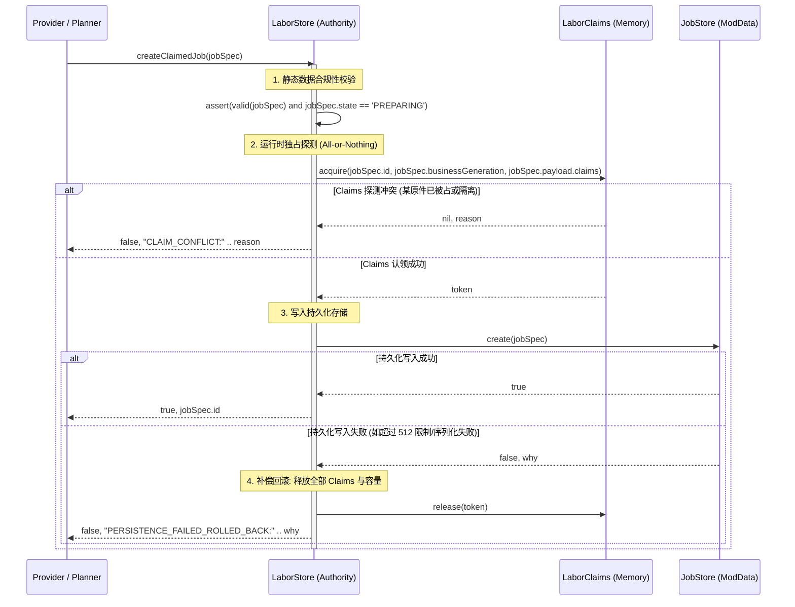

# 阶段 3A 设计规格书：工单契约标准化与 BusinessJobs 去特权化 (v1.5 执行范围修订版)
# (Phase 3A: Job Contract Standardization & BusinessJobs Deprivileging)

> 修订：2026-11-01｜版本：v1.5｜状态：用户已确认主路线；B.5 等待独立验收，Stage C 冻结｜原始设计基线：`d43404dc`｜本轮审查基线：`dc8e17c`

---

## 0. 当前执行裁决（2026-11-01，覆盖旧稿冲突内容）

用户已明确不需要旧档迁移，并授权本地 Codex 主导实施和进度，外部 AI 负责独立审查。本文与 [Final Errata](2026-10-31-phase3a-v14-final-errata.md) 同步修订；文件名保留以维持既有链接。正文是目标契约，不是实现或实机验收证明，进度只维护 [BACKLOG](../../BACKLOG.md)。

| 顺序 | 范围 | 交付与门禁 |
|---|---|---|
| 1 | 收紧 3A | 取消旧账本导入、转换、迁移指纹和迁移状态机。支持的格式正常保存恢复；不支持的历史格式须在写入、清理或覆盖之前明确拒绝。严格门禁仍须沿真实入口验证，不因规格修改即记完成。 |
| 2 | 关闭 B.5 | 修复重复隔离 F1 和重复 addKeys；保留已通过的身份、容量、Evidence 契约；完成 LuaLS 与 PZ 正常保存、退出、重进的独立证据，再交外部审查。不得以宿主复制替代磁盘验证。 |
| 3 | Stage C | 制作优先、搬运其次；逐链切换统一创建和 Claim 变更，验证物理执行、中断、取消及保存恢复，再确认无调用后删除对应旧写入口。B.5 未验收不得开始。 |
| 4 | 3B | Provider 证明业务效果，公共机制核对 Job 原件与责任，Order 判断订单完成；不另建结算权威。 |
| 5 | 3C / 3D | 先核查制作工具 Custody 的实际接入，复用现有认领、归还和中止链路；按真实缺口补齐，再基于制作与搬运的稳定差异提取资源契约。既有“完成”记录不是重复开发依据。 |

共同验收原则：新接口通过测试不等于重构完成；真实业务切换及旧写入口退出都必须有证据。JobStore 管持久事实，LaborClaims 管资源协调，Provider 管物理执行及业务证据，TaskRuntime 管执行生命周期，Order 管上层订单。候选仲裁不得拥有第二份活动任务状态或身体控制权。

暂缓：继续扩充通用机制、新事务协调层、通用资源框架和大规模拆文件。保持各 Provider 的物理执行、失败处理及释放语义。开发阶段不追加“任意崩溃零损失”门禁；保留原件责任和未知效果保护，正式发布的崩溃恢复范围与数据丢失窗口另行设计并验证。

B.5 F1 边界：Evidence 重复事件使用固定层级集合；每份事实按原深度/节点/表项/字符串限额独立快照，集合最多 64 条。超过集合上限明确记录 `EVENT_HISTORY_LIMIT` 并保留不完整状态，不能伪装 `DEPTH_LIMIT`，不能放宽释放守卫。重复 addKeys 在扩展、CAS 和隔离前拒绝。历史完成审计不自动清洗或迁移。

## 目录
1. [基线事实与核心版本概念澄清 (P0-1)](#1-基线事实与核心版本概念澄清-p0-1)
2. [标准 Job Schema 与不可逾越状态机 (P0-1)](#2-标准-job-schema-与不可逾越状态机-p0-1)
3. [统一 Job 创建与 Claim 变动协议 (P0-2)](#3-统一-job-创建与-claim-变动协议-p0-2)
4. [CRAFT 与 HAUL 状态感知资源映射 (P0-3)](#4-craft-与-haul-状态感知资源映射-p0-3)
5. [Quarantine 全局不可伪造所有权与冷启动恢复 (P0-4)](#5-quarantine-全局不可伪造所有权与冷启动恢复-p0-4)
6. [存档支持边界与写入前拒绝 (P0-5)](#6-存档支持边界与写入前拒绝-p0-5)
7. [BusinessJobs 全面去特权化与全库调用点重构 (P0-6)](#7-businessjobs-全面去特权化与全库调用点重构-p0-6)
8. [物理操作、Job CAS 与 Runtime Claims 的三层故障恢复模型](#8-物理操作-job-cas-与-runtime-claims-的三层故障恢复模型)
9. [单 NPC 单活动运行时与任务恢复仲裁](#9-单-npc-单活动运行时与任务恢复仲裁)
10. [冷启动绝对顺序与硬门禁屏障](#10-冷启动绝对顺序与硬门禁屏障)
11. [全生命周期压力测试矩阵 (T01~T03, T17~T33)](#11-全生命周期压力测试矩阵-t01t03-t17t33)

---

## 1. 基线事实与核心版本概念澄清 (P0-1)

经过第二轮终审核验，当前系统存在四个不同维度的版本与代次概念，在 v1.4 中确立严格正交的单一职责：

| 字段名称 | 归属层级 | 唯一核心职责 | 变动规则 |
|---|---|---|---|
| **`root.jobContractVersion`** | 全局 ModData 根表 | 标记整模组工单基础设施契约版本 | 由明确的新世界初始化建立目标版本；禁止用版本字段触发旧档迁移。当前接入状态须源码核验 |
| **`taskJobs.format`** | JobStore 存储容器 | 标记 `root.taskJobs` 字典自身的容器格式 | 固定为 1（由 `JobStore.open` 严格校验） |
| **`job.revision`** | Job 公共包络 | CAS 乐观并发控制锁版本 | 每次调用 `JobStore:update` 时自增 1 |
| **`job.businessGeneration`** | Job 公共包络 / 载荷 | 执行代次与回调隔离防护标记 | 角色分配、物理打断或重进恢复时递增，隔离过期回调 |
| **`payload.format`** | 工种专有私有载荷 | 标记各 Provider 业务 Schema 演进版本 | CRAFT=4, HAUL=3, FIELD_WORK=1, COOKING=1 |
| **`payload.sequence`** | 工种专有私有载荷 | 载荷内部状态跃迁与认领时序 | 每次资源变更或业务 phase 推进时递增 |

---

## 2. 标准 Job Schema 与不可逾越状态机 (P0-1)

严格对齐 [JobStore.lua](file:///c:/Users/MuMu/Zomboid/Workshop/EmberRoutes/Contents/mods/EmberRoutesProbe/42/media/lua/shared/EmberRoutesProbe/JobStore.lua) 的物理约束，补齐专有校验与终态约束：

### 2.1 公共包络规范 (Standard Job Envelope)
```lua
-- root.taskJobs.byId[jobId] 标准包络
{
    id = "uuid",                     -- [必需, string, 长度<=256] 稳定主键
    npcId = "uuid",                  -- [必需, string, 长度<=256] 执行人角色 ID (严格要求 string，杜绝 number)
    providerType = "STRING",         -- [必需, string] 'FIELD_WORK'|'CRAFT'|'HAUL'|'COOKING'|'SELF_CARE'|'ACTIVITY'
    scopeId = "settlement-uuid",     -- [必需, string] 据点 ID 或 'local-world'
    orderId = "order-uuid" | nil,    -- [可选, string] 上层订单关联 ID
    revision = 1,                    -- [必需, integer, >=1] CAS 乐观锁版本号
    state = "PREPARING",             -- [必需] PREPARING | RUNNING | STOPPING | SUSPENDED | SETTLING | DONE | CANCELLED | RECONCILE_REQUIRED
    effects = "KNOWN",               -- [必需] 'KNOWN' | 'UNKNOWN'
    obligations = {},                -- [必需, table] 跨工单持久责任字典，终态必须为空
    businessGeneration = 0,          -- [必需, integer, >=0] 执行代次标记 (保留用于回调隔离)
    payload = {                      -- [必需, table] 业务私有载荷
        format = 1,                  -- 载荷格式版本
        sequence = 0,                -- 载荷内部时序计数器
        claims = {},                 -- [权威排他原件键列表] 如 {"item:1001", "craft-surface:bench_1"}
        target = {},                 -- 空间或实体目标
        ...
    }
}
```

### 2.2 不可逾越的状态机流转表
消除 v1.3 中的状态跃迁矛盾，严格执行：
```
PREPARING   --> RUNNING | SUSPENDED | SETTLING | RECONCILE_REQUIRED
RUNNING     --> STOPPING | RECONCILE_REQUIRED  (注: 严禁从 RUNNING 直接跳入 SETTLING 或 SUSPENDED)
STOPPING    --> SUSPENDED | SETTLING | RECONCILE_REQUIRED
SUSPENDED   --> PREPARING | SETTLING | RECONCILE_REQUIRED
SETTLING    --> DONE | CANCELLED | SUSPENDED | RECONCILE_REQUIRED
RECONCILE_REQUIRED --> SUSPENDED | SETTLING
DONE / CANCELLED   --> (终态无出边)
```

### 2.3 JobStore.valid() 终态硬性约束与 Validator 挂接
在 [JobStore.lua:valid(job)](file:///c:/Users/MuMu/Zomboid/Workshop/EmberRoutes/Contents/mods/EmberRoutesProbe/42/media/lua/shared/EmberRoutesProbe/JobStore.lua#L34) 中增加终态无资源占用不变量与工种验证器：
1. **终态无责任不变量**：
   ```lua
   if terminal[job.state] then
       if job.effects ~= 'KNOWN' or not empty(job.obligations) or #(job.payload.claims or {}) > 0 then
           return false -- 终态必须清空 claims，严禁残留物理原件责任
       end
   end
   ```
2. **挂接 CRAFT 与 HAUL 专有 Validator**：
   ```lua
   and (job.providerType ~= 'CRAFT' or require('EmberRoutesProbe/CraftRecord').valid(job))
   and (job.providerType ~= 'HAUL' or require('EmberRoutesProbe/HaulManifest').validJob(job))
   ```

---

## 3. 统一 Job 创建与 Claim 变动协议 (P0-2)

彻底解决“Job 写入与 Runtime Claim 割裂”以及“仅支持 shrink 无法覆盖全生命周期”的重大缺陷，建立覆盖全工种的统一事务入口：

### 3.1 统一创建原子事务：`LaborStore.createClaimedJob(job)`
任何 Provider（CRAFT、HAUL、FIELD_WORK 等）创建需要占用资源的新工单时，**严禁直接调用 `JobStore:create`**，必须经由原子事务：



### 3.2 统一状态与资源变动事务：`LaborStore.mutateJobClaims`
统一处理资源增加、释放、替换及容量变更，确保业务字段（`manifest`, `outputs`, `reservation`）与 `claims` 在同一次 CAS 中原子落盘：

```lua
-- LaborStore.lua 统一资源变动核心
function Store.mutateJobClaims(jobId, expectedRevision, proposedPayload, mutationKind, mutationKeys)
    -- mutationKind: 'ADD' | 'REMOVE' | 'REPLACE'
    local store = TaskJobs.current()
    local job = store:get(jobId)
    if not job or job.revision ~= expectedRevision then return false, 'STALE_REVISION' end
    local token = claimsTokens[jobId]
    
    if mutationKind == 'ADD' then
        -- 先保护，后持久化
        local ok, why = Claims:extend(token, mutationKeys)
        if not ok then return false, 'EXTEND_LOCK_FAILED:' .. tostring(why) end
        local okCAS, nextRev = store:update(jobId, expectedRevision, { payload = proposedPayload })
        if not okCAS then
            -- CAS 失败保持 Token 保护，转入安全暂停核查，绝不遗漏新产物
            job.state = 'SUSPENDED' job.effects = 'UNKNOWN'
            store:update(jobId, expectedRevision, { state = 'SUSPENDED', effects = 'UNKNOWN' })
            return false, 'CAS_FAILED_RETAINED_LOCK'
        end
        return true, nextRev
        
    elseif mutationKind == 'REMOVE' then
        -- 先持久化，后释放
        local okCAS, nextRev = store:update(jobId, expectedRevision, { payload = proposedPayload })
        if not okCAS then return false, 'PERSISTENCE_FAILED_TOKEN_RETAINED' end
        -- 持久化成功后缩减内存 Token
        Claims:shrink(token, mutationKeys)
        return true, nextRev
        
    elseif mutationKind == 'REPLACE' then
        -- 先取并集，写持久化，再收缩旧差集
        local addKeys, dropKeys = diffSets(token.resources, mutationKeys)
        local ok, why = Claims:extend(token, addKeys)
        if not ok then return false, 'REPLACE_EXTEND_FAILED:' .. tostring(why) end
        local okCAS, nextRev = store:update(jobId, expectedRevision, { payload = proposedPayload })
        if not okCAS then return false, 'REPLACE_CAS_FAILED' end
        Claims:shrink(token, dropKeys)
        return true, nextRev
    end
end
```

### 3.3 全 Provider 现有路径收敛矩阵
彻底改造 [LaborStore.lua](file:///c:/Users/MuMu/Zomboid/Workshop/EmberRoutes/Contents/mods/EmberRoutesProbe/42/media/lua/client/EmberRoutesProbe/LaborStore.lua) 中全部 11 处分散的变更逻辑：
- `claimNative` / `extendNative` / `replaceNative` / `finishNative` $\rightarrow$ 统一委托 `createClaimedJob` 与 `mutateJobClaims`；
- `claim` / `upgradeHaul` / `settleHaulLines` $\rightarrow$ 统一委托 `mutateJobClaims`；
- `replaceCooking` / `replaceField` $\rightarrow$ 统一委托 `mutateJobClaims`；
- `releasePersonalSeats` / `finishPersonal` / `finishActivity` $\rightarrow$ 严格执行“先 CAS 更新 `job.payload.claims`，后 `Claims:shrink/release`”。

---

## 4. CRAFT 与 HAUL 状态感知资源映射 (P0-3)

针对已释放工单依然计算出工作台等资源的历史缺陷，废除粗暴的 `resources()` 强等式，确立**状态感知的资源映射权威**：

### 4.1 CRAFT 状态感知提取器：`CraftRecord.activeClaims(r)`
```lua
function CraftRecord.activeClaims(r)
    -- 1. 已明确释放或属于 assetFree 纯手工工单：必须无资源声明
    if r.released == true or require('EmberRoutesProbe/ProductionYield').assetFree(r) then
        return {}
    end
    
    local result = {}
    -- 2. 仅在未完成制作时锁定工作台表面
    if r.benchId and r.phase ~= 'CONFIRMED' and r.phase ~= 'RETURNING' and r.phase ~= 'DONE' then
        result[#result+1] = "craft-surface:" .. r.benchId
    end
    
    -- 3. 未消耗材料
    for _, m in ipairs(r.materials or {}) do
        if not m.consumed then result[#result+1] = "item:" .. m.id end
    end
    -- 4. 正在使用的工具 (3A 保留，待 3C 转 Custody)
    for _, t in ipairs(r.tools or {}) do result[#result+1] = "item:" .. t.id end
    -- 5. 已生成但未交付的产物
    for _, o in ipairs(r.outputs or {}) do
        if not o.delivered then result[#result+1] = "item:" .. o.id end
    end
    -- 6. 多步骤暂存中间件
    for _, h in ipairs(r.held or {}) do result[#result+1] = "item:" .. h.id end
    
    return result
end
```

### 4.2 HAUL 状态感知提取器：`HaulManifest.activeClaims(r)`
```lua
function HaulManifest.activeClaims(r)
    if r.state == 'DONE' or r.state == 'CANCELLED' then return {} end
    local result = {}
    if r.format == 2 then
        for _, l in ipairs(r.manifest or {}) do
            -- 仅对未送达、未撤回的受保护原件持有 Claims
            if l.custodyState ~= 'DELIVERED' and l.custodyState ~= 'WITHDRAWN' then
                result[#result+1] = "item:" .. l.itemId
            end
        end
    else
        -- format=1 兼容：仅在非终态时持有未结算物品
        for _, id in ipairs(r.items or {}) do result[#result+1] = "item:" .. id end
    end
    return result
end
```

- **一致性强制断言**：在任何非终态，必须恒成立：`job.payload.claims ≡ Provider.activeClaims(job.payload)`。

---

## 5. Quarantine 全局不可伪造所有权与冷启动恢复 (P0-4)

### 5.1 隔离所有权下沉至 LaborClaims 内核
彻底杜绝外部模块直接侵入 `claims.owners` 表或直接获取可变 Claims 单例。在 [LaborClaims.lua](file:///c:/Users/MuMu/Zomboid/Workshop/EmberRoutes/Contents/mods/EmberRoutesProbe/42/media/lua/shared/EmberRoutesProbe/LaborClaims.lua) 内部实现不可伪造的系统隔离锁：

```lua
-- LaborClaims.lua 内核方法
local SYSTEM_QUARANTINE_TOKEN = { taskId = "SYSTEM_QUARANTINE", generation = -1, resources = {} }

function methods:quarantine(key, reason)
    local existing = self.owners[key]
    if existing and existing == SYSTEM_QUARANTINE_TOKEN then return true end
    -- 强制剥夺并占有所有权，普通 Job 的 release/shrink 无法解除
    self.owners[key] = SYSTEM_QUARANTINE_TOKEN
    self.revision = self.revision + 1
    return true
end

function methods:isQuarantined(key)
    return self.owners[key] == SYSTEM_QUARANTINE_TOKEN
end
```

### 5.2 严格 API 隔离（消除原始 Token 与可变 Claims 泄漏）
改造 [LaborStore.lua](file:///c:/Users/MuMu/Zomboid/Workshop/EmberRoutes/Contents/mods/EmberRoutesProbe/42/media/lua/client/EmberRoutesProbe/LaborStore.lua) 中向外暴露可变引用的危险接口：
- `Store.owner(itemId)` $\rightarrow$ **返回只读脱水快照** `{ taskId = owner.taskId, isQuarantined = ... }`，严禁返回内部 Token 引用；
- `Store.resourceOwner(key)` $\rightarrow$ 返回只读快照；
- `Store.claimsVersion()` $\rightarrow$ **仅返回整数版本号 `claims.revision`**，严禁返回 `claims` 自身实例。

### 5.3 双遍扫描全覆盖 (Two-Pass Scan) 与双向冻结
在 `LaborStore.data()` 重建全流程中覆盖所有资源（Job、ToolCustody、历史 Quarantine）：

```mermaid
flowchart TD
    Start[读档触发 Store.data] --> CleanClaims[1. Claims.new 初始化内存锁]
    CleanClaims --> ReInjectQ[2. 优先恢复 root.quarantineResources 隔离锁]
    ReInjectQ --> Pass1[3. Pass 1 扫描: 收集全部活跃 Job 与 Custody 的 claims]
    Pass1 --> BuildMap[建立 resourceKey 到声明者列表映射: usage[key] = {owner1, owner2}]
    BuildMap --> Pass2[4. Pass 2 裁决: 遍历 usage 映射]
    Pass2 --> Conflict{声明者数量 > 1 ?}
    Conflict -- 是 (发生冲突) --> DualFreeze[双向冻结: 双方任务打上 RECONCILE_REQUIRED / UNKNOWN<br/>并将该 key 立即调用 Claims:quarantine 锁定]
    Conflict -- 否 (独占合法) --> NormalAcquire[为唯一合法者执行 Claims:acquire]
    DualFreeze --> Finish
    NormalAcquire --> Finish[5. 发布全新不可变 Claims 快照]
```

- **覆盖 ToolCustody 冲突**：若冲突双方为 `Job` 与 `ToolCustody`，将该 Job 置为 `RECONCILE_REQUIRED`，并将 `ToolCustody` 的状态置为 `RECONCILE_REQUIRED`，涉事原件立即隔离；
- **覆盖终态 Job 冲突**：若涉及已处于 `DONE` 的记录，调用专用隔离转移接口将终态异常记录移入 `root.quarantineJobs`，绝不假定普通 CAS 可修改终态记录。

---

## 6. 存档支持边界与写入前拒绝 (P0-5)

2026-11-01 用户明确取消旧账本迁移。本节取代 v1.4 的迁移实现，不再开发 `JobMigration`、Staging、迁移指纹、旧账本替换或清理流程。历史原文可从 Git 查询，不能作为当前执行任务。

默认保证当前受支持存档格式的正常保存与恢复。对明确不支持的历史格式，不要求迁移兼容；必须在任何数据写入之前识别并明确拒绝加载，不得自动修改、清理、覆盖原始记录或重造物理原件。

新世界空账本初始化与已有账本打开必须区分。已有账本须先只读校验根格式、容器格式、Job 包络、Provider 载荷及可序列化事实；拒绝不能偷偷创建空表、写新版本或清除旧表。当前 `JobStore.open` 有旧结构/记录拒绝，但 `ContainerRegistry.data` 仍可能先初始化根字段；完整的最早入口门禁是待核验/补齐项，不在本轮 Evidence F1 中夹带修改。

不兼容旧档不等于立即删除当前业务所用的旧适配接口。Stage C 先切换真实调用、在新建测试世界验收，再退役无调用的旧写入口与格式分支。此前对当前有效搬运记录的单独有界升级授权，不扩大为全面旧档兼容，也不作为未来默认迁移任务。

---

## 7. BusinessJobs 全面去特权化与全库调用点重构 (P0-6)

### 7.1 架构职责彻底剥离与只读化
将原本臃肿的 `BusinessJobs.lua` 拆分为职责明确的单向依赖结构：
- **`BusinessJobs.lua`（仅提供只读查询投影）**：
  - 彻底删除 `flush()`、`refresh()`、`publishCraft()`、`publishHaul()`；
  - 彻底移除对 `j.state`、`j.revision`、`j.payload = r` 的内存直接写入；
  - 查询接口全部返回由 `JobStore` 产出的 Detached Copy：
    - `BusinessJobs.get(jobId)`
    - `BusinessJobs.records(providerType)`
    - `BusinessJobs.forNpc(npcId)`
    - `BusinessJobs.activeForNpc(npcId, providerType)`
- **`BusinessJobLifecycle.lua`（临时收敛退役过渡逻辑）**：
  - 暂时存放 `canRetire(jobId)` 与 `retire(jobId)` 业务检查，由 `TaskRetirement.lua` 受控调用，待 3B 彻底收口。

### 7.2 现有直接写 Payload 隐患全面清理表

| 涉事文件 | 原有直接写代码 | 3A 规范重构方案 |
|---|---|---|
| [HaulAgent.lua:45](file:///c:/Users/MuMu/Zomboid/Workshop/EmberRoutes/Contents/mods/EmberRoutesProbe/42/media/lua/client/EmberRoutesProbe/HaulAgent.lua#L45) | `line.custodyState = 'CARRIED'`<br/>`r.activeAttempt = nil` | 改为调用 `LaborStore.mutateJobClaims(jobId, rev, updatedPayload, 'REMOVE', ...)` CAS 更新 |
| [Production.lua:88](file:///c:/Users/MuMu/Zomboid/Workshop/EmberRoutes/Contents/mods/EmberRoutesProbe/42/media/lua/client/EmberRoutesProbe/Production.lua#L88) | 原地修改 `r.phase`、`r.uncertain` | 改为调用 `updateJobPayload(jobId, rev, editFn)` 提交 CAS 更新 |
| [TaskPersistence.lua:48](file:///c:/Users/MuMu/Zomboid/Workshop/EmberRoutes/Contents/mods/EmberRoutesProbe/42/media/lua/client/EmberRoutesProbe/TaskPersistence.lua#L48) | `BusinessJobs.flush()` | **彻底删除此调用**，持久化 facts 随每次 CAS 实时安全落盘 |
| [LaborStore.lua](file:///c:/Users/MuMu/Zomboid/Workshop/EmberRoutes/Contents/mods/EmberRoutesProbe/42/media/lua/client/EmberRoutesProbe/LaborStore.lua) | 直接穿透读 `root.taskJobs.byId` | 改为通过 `TaskJobs.current():records()` 只读接口遍历 |

---

## 8. 物理操作、Job CAS 与 Runtime Claims 的三层故障恢复模型

严格遵循三层故障恢复模型，杜绝把内存 CAS 误认为磁盘事务：

### 8.1 CRAFT 制作新产物故障与 Scope Quarantine Fence
在制作 `COMMITTING` 阶段，原生动作消耗了材料并产出了新物品 B：
1. **正常路径**：
   新物品 B 生成 $\rightarrow$ 确认其物理 ItemID $\rightarrow$ `mutateJobClaims(..., 'ADD', {"item:B"})` 提交 CAS 更新并扩展 Token $\rightarrow$ 状态推进为 `CONFIRMED`；
2. **故障窗口应对 (Scope Quarantine Fence)**：
   若原生制作完成，但 CAS 尚未提交成功游戏即遭遇掉电或崩溃：
   - 读档恢复时，由于无法在旧 claims 中找到新产物 B，且原材料已被物理扣减，系统检测到物理事实与 Job 声明不符；
   - **立即触发 Scope Quarantine Fence**：将该 Job 标记为 `RECONCILE_REQUIRED` 与 `effects = 'UNKNOWN'`，并在该据点（`scopeId`）设立安全围栏，暂时挂起涉及该制作台的后续派工，记录日志 `NEW_PRODUCT_UNRECONCILED`，等待离线对账探针核对物品归属，**绝不放任新产物脱保流失**。

---

## 9. 单 NPC 单活动运行时与任务恢复仲裁

### 9.1 责任持有与执行候选分离
- **`retainedJobsForNpc(npcId)`**：返回该 NPC 持有的所有尚未结清物理责任的 Job 列表（包括 `SUSPENDED`、`SETTLING` 等）；
- **`executionCandidateForNpc(npcId)`**：根据仲裁矩阵选出**唯一一个**允许进入 `TaskRuntime` 激活身体的候选 Job。

### 9.2 确定性恢复仲裁矩阵 (Deterministic Arbitration Matrix)
当一个 NPC 关联多个可恢复 Job 时，禁止使用 `pairs()` 遍历顺序，严格按以下确定性次序仲裁：
1. **Priority 1 (生命安全自理)**：`SELF_CARE`（危急吃喝治疗）；
2. **Priority 2 (玩家命令与抢占)**：随从跟随、去睡觉等用户显式指令；
3. **Priority 3 (必须完结的物理责任)**：手持未交付物品的 `HAUL`（`holding`）或处于 `DELIVER` 阶段的 `FIELD_WORK`；
4. **Priority 4 (已认领材料的制作)**：处于 `CRAFTING` / `COMMITTING` 阶段的 `CRAFT`；
5. **Priority 5 (普通可重新认领的外勤)**：处于 `PREPARING` 的 `FIELD_WORK`。
若同级存在多个候选且无法决出优先级，**全部保持 SUSPENDED 并记录诊断**，绝不允许并发执行。

---

## 10. 冷启动绝对顺序与硬门禁屏障

### 10.1 冷启动执行顺序锁定
在 [TaskPersistence.lua:Save.load()](file:///c:/Users/MuMu/Zomboid/Workshop/EmberRoutes/Contents/mods/EmberRoutesProbe/42/media/lua/client/EmberRoutesProbe/TaskPersistence.lua#L43) 中严格遵循以下次序：
```
1. 支持格式的最早只读校验                   -- [阶段 0: 不支持则在任何写入前拒绝；不迁移]
2. Probe.prepareMembershipRecovery()        -- [阶段 1: 会员与归属恢复]
3. Craft.prepareRecovery()                  -- [阶段 2: 规范化恢复 - 必须使用 CAS 提交暂停]
4. Store.data()                             -- [阶段 3: 恢复 Quarantine 锁并双遍扫描重建全部 Claims]
5. FieldWork.prepareRecovery()              -- [阶段 4: 现场任务恢复]
6. Runtime 开放准入门禁                    -- [阶段 5: 调度器启动]
```

### 10.2 存档最早入口门禁

禁止机械加入“版本不等于 2 就迁移”或“缺表就创建空账本”的路径。已有存档在 Registry 默认值写入、恢复归一化及 Runtime 准入之前先完成支持格式校验；真正的新世界经明确初始化流程创建当前格式。

本项是目标契约，须以启动真实调用链和拒绝前后原表不变的测试证明。当前 B.5 的 Evidence/Claims 重建不构成该最早入口已完成的证据；后续实施不得跳过现有真实业务所需的格式支持。

---

## 11. 全生命周期压力测试矩阵 (T01~T03, T17~T33)

以下是跨阶段验收矩阵，按所属阶段验证并分别记录宿主、实机和未运行项，不把后续目标算作 B.5 已完成。T01/T02/T19/T27/T30 的旧迁移要求已撤销并替换；其余项也不得凭编号或旧报告宣布完成。

| 编号 | 测试用例分类 | 核心断言与破坏性注入场景 |
|---|---|---|
| **T01** | 不支持格式拒绝 | 加载不支持的旧根表、容器或载荷；明确拒绝，原表、版本、世界原件不变，不导入或清理。 |
| **T02** | 拒绝幂等与新世界初始化 | 重复拒绝同一不支持账本无写入；新世界显式初始化只产生一个受支持空账本，不重置已有记录。 |
| **T03** | 资源互斥排他 | 材料或工作台被 Job A 认领后，Job B 在 DISCOVER 阶段认领该资源直接被拒绝并退避。 |
| **T17** | Custody 与退役解耦 | CRAFT Job 结清退役注销，NPC 背包中的工具 Custody 完好无损，不随 Job 删除而丢失。 |
| **T18** | **创建补偿全回滚** | 模拟 `LaborClaims:acquire` 成功但在 `store:create` 时抛错，断言调用 `Claims:release` 100% 释放全部 Claims 与容量。 |
| **T19** | 写入前门禁完整性 | 沿 Registry、恢复和 Runtime 准入检查不支持格式在第一次写入之前拒绝；不进行迁移断点或指纹重试。 |
| **T20** | CRAFT 复杂资产保护 | 验证受支持 CRAFT 的未消耗材料、产物、工具、held 与设施声明受保护，且正确区分 assetFree；不导入旧记录。 |
| **T21** | HAUL 增量交付存盘 | 搬运 5 件物品，送仓 2 件，存盘退出重进，读档后 claims 仅恢复剩余 3 件，已入库 2 件绝不重新上锁。 |
| **T22** | **跨层一致性与故障围栏**| 注入两个故障窗口（物理完成 CAS 未成、CAS 成功 shrink 未成），并在 CRAFT 产物未决时断言触发 Scope Quarantine Fence。 |
| **T23** | 多 Job 与单 Runtime | 验证同一 NPC 持有 SUSPENDED、PREPARING、DONE 多个 Job 共存，但在 TaskRuntime 中任何时刻仅允许最多一个物理执行。 |
| **T24** | **全实体隔离双向冻结** | 模拟 Job 与 Job、以及 Job 与 ToolCustody 发生原件冲突，验证双方全部进入 RECONCILE_REQUIRED，涉事资源全局隔离。 |
| **T25** | CAS 失败锁不丢 | 模拟材料扣减时 CAS update 遭遇版本冲突失败，断言原件责任与内存 Token 绝不静默丢弃，维持锁保护。 |
| **T26** | **Envelope 容错隔离** | 注入包含循环引用或字段损坏的非法 Job，验证 `Store.open` 成功打开其余健康 Job，并将坏单隔离到 `quarantineJobs`。 |
| **T27** | 不支持账本硬门禁 | 已有存档的根格式、容器格式、载荷版本不受支持时，所有打开/恢复入口在写入前拒绝；不能静默造空账本。 |
| **T28** | **Payload 只读副本保护**| 外部代码尝试直接修改 `BusinessJobs.get(id).payload` 的属性，验证 `JobStore` 中的底层持久化数据不受任何影响。 |
| **T29** | **终态无 claims 约束** | 验证处于 `released` 的 CRAFT 和已交付的 HAUL 工单，其 `payload.claims` 必须强制为空，否则 `JobStore.valid` 拒绝。 |
| **T30** | 旧入口退役证明 | 真实 Production / Haul 切换后检索调用方，确认对应旧写入口无人调用；新建世界验证后方可删除。 |
| **T31** | **Quarantine 重进持久性**| 隔离某资源后存盘退出重进，验证 `Store.data()` 重建 Claims 时该资源依然直接处于不可认领状态。 |
| **T32** | **隔离权限绝对防绕过** | 针对处于隔离状态的原件，验证普通 Job、ToolCustody 以及所有 Provider 的认领入口均直接报 `ITEM_RESERVED` 被阻断。 |
| **T33** | 多物品容量预约一致性 | 对当前受支持 HAUL 记录验证 CAS、正常保存重进与部分交付的容量守恒；不以表复制代替实际磁盘保存。 |
